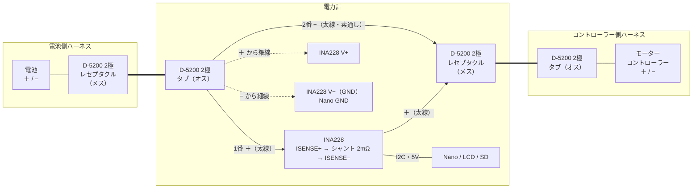

# Ene1PowerMeter

Ene-1 GP（電動カー競技）用の車載電力計。Arduino Nano で INA228 から電圧・電流・電力・積算 mAh を読み、20×4 I2C 液晶に表示して microSD に CSV で記録する。

## ハードウェア

| 部品 | 内容 |
|---|---|
| マイコン | Arduino Nano（ATmega328P / 5V） |
| 電流・電圧センサー | Strawberry Linux #11228（INA228、シャント 2mΩ、I2C 0x40）。ローレンジ（±40.96mV）で 20A まで測定 |
| 表示 | 秋月 ACM2004D-FLW-FBW-IIC（20×4、RW1063） |
| 記録 | microSD モジュール（SPI、CS = D10） |
| ボタン | D2–GND 間（3 秒以上押して離す＝積算リセット） |
| 大電流の端子 | TE Dynamic D-5200 シリーズ 2 極（電池側・モーターコントローラー側に 1 組ずつ）。[下の配線](#電池モーターコントローラーとの接続te-dynamic-d-5200) |

| ピン | 用途 |
|---|---|
| A4 / A5 | I2C SDA / SCL（4.7kΩ で 5V へプルアップ） |
| D10 / D11 / D12 / D13 | SD の CS / MOSI / MISO / SCK |
| D2 | ボタン |

### INA228 モジュール（#11228）の配線

基板の印字とメーカーの図による。

| 端子 | つなぎ先 |
|---|---|
| ISENSE+ | 電池＋（電流の入口。シャント 2mΩ を通って ISENSE− へ） |
| ISENSE− | モーターコントローラー＋（電流の出口） |
| V+ | 電池＋（バス電圧の測定用。**ISENSE+ とは基板上でつながっていないので、別に配線する**。未接続だと電圧と電力が 0 になる。mAh は電流だけから積算するので影響しない） |
| V−（GND） | 電池− |
| VS | Nano の 5V（3〜5V） |
| GND | Nano の GND |
| SDA / SCL | A4 / A5 |
| AL | 使わない（未接続でよい） |

- **I2C アドレスのジャンパー**: A1 と A0 を、それぞれ `G`（GND）の列とはんだでつなぐと 0x40 になる。どこにもつながっていない（浮いている）と INA228 のアドレスが定まらないので、必ずつなぐ。
- モジュールの GND と V− の関係、I2C のプルアップ抵抗が基板に載っているかどうかは未確認。載っていれば、外付けの 4.7kΩ と並列になる。電源を切った状態で、SDA–VS 間の抵抗をテスターで測って確認する。
- ねじ端子の電流定格は未確認。20A 近く流すなら、シャント両側の金色の大きなパッド（穴あき）の用途を基板で確認する。

### 電池・モーターコントローラーとの接続（TE Dynamic D-5200）

電力計は、電池とモーターコントローラーの間に **D-5200 の 2 極コネクタ 2 組**で割り込ませる。電力計を外したときは、電池側とコントローラー側のハーネスを直接つなげば走れる。



| 極 | 電池側ハーネス（レセプタクル） | 電力計の入口（タブ） | 電力計の出口（レセプタクル） | コントローラー側ハーネス（タブ） |
|---|---|---|---|---|
| 1 番 | 電池＋ | → INA228 ISENSE+、細線で V+ | ← INA228 ISENSE− | → コントローラー＋ |
| 2 番 | 電池− | → 出口の 2 番へ素通し、細線で INA228 V−・Nano GND | ← 入口の 2 番 | → コントローラー− |

- **どちらがオスか**: 電気が来ている側（電池側ハーネスと、電力計の出口）を**レセプタクル（メス）**にする。抜いたとき、電気の来ている金属がむき出しにならない。電池側（メス）とコントローラー側（オス）がそのままはまるので、電力計を外しても走れる。
- **極の割り当て**: 4 か所とも 1 番＝＋、2 番＝− にそろえる。ハウジングに極の番号が刻印されているので、圧着の前に確かめる。
- **太線にするところ**: 電池＋→ISENSE+、ISENSE−→出口の 1 番、入口の 2 番→出口の 2 番（−の素通し）。どれも 20A 流れるので、**AWG14（約 2mm²）以上**にする。コンタクトが使う電線の太さに合っているかを、品番で確かめる。
- **細線でよいところ**: V+ と、INA228 の V−（GND）・Nano の GND への線。電流はほとんど流れない。V+ は ISENSE+ と基板上でつながっていないので、入口の 1 番から別に引く（[上の表](#ina228-モジュール11228の配線)）。
- **GND を共通にする**: Nano の GND は、入口の 2 番（電池−）から 1 本でつなぐ。INA228 は GND を基準に電圧を測るので、ここがつながっていないと電圧と電力がおかしくなる。モーターの電流が流れる線の途中ではなく、コネクタの 2 番から直接引く（[TROUBLESHOOTING](docs/TROUBLESHOOTING.md) の「電圧が負荷で大きく下がって見える」）。
- **定格**: TE の資料では D-5200 は UL 45A・630V・ピッチ 10.16mm。20A には余裕があるが、コンタクトに対する電流値は電線の太さで変わるので、使うコンタクトの資料で確かめる。
- **キー**: 誤ってほかのコネクタとはまらないようにするキー（ハウジングの種類）がある。電池側とコントローラー側を直接つなぐ使い方をするので、**4 か所とも同じキーのハウジング**にそろえる。
- **圧着**: コンタクトは専用の圧着工具で圧着する。ペンチでかしめると、振動で抜けたり発熱したりする。ロックが「カチッ」と鳴るまで差し込む。

## 表示

2 行目の `Q:` はリセットからの積算 mAh（INA228 の CHARGE レジスタ）。

```
V: 24.53V  I: 12.34A
P: 303W  Q:  1234mAh
TIME  12:34
REC LOG003.CSV     *
```

## ボタン

| 操作 | 動作 |
|---|---|
| 3 秒以上押して離す | 積算 mAh と経過時間を 0 にして、新しいログファイルを作る。押している間は 4 行目に `RELEASE=RESET mAh` |
| 3 秒未満で離す | 何もしない |
| 10 秒以上押したまま | 配線のショートとみなし、離しても何もしない（4 行目に `BUTTON STUCK?`） |

リセットを「離したとき」に行うのは、ボタン線が挟まれて GND とショートしても走行中の積算が消えないようにするため。

SD カードの初期化は起動時だけ行う。走行中に `NO SD` になった場合は、電源を入れ直すまで記録しない（表示と積算は続く）。

## 故障への備え

- **Nano だけがリセットされたとき**（ウォッチドッグ、スケッチの書き込み、Nano のリセットボタンなど）は、INA228 に設定が残っていれば積算 mAh を消さずに再開する。経過時間も、リセットで消えない RAM 領域（`.noinit`）から復元する。新しいログファイルは作るが、時刻は続きから記録する。
- **走行中に INA228 の設定が消えたとき**（電源の瞬断など）は、それを検出して設定し直し、それまでの積算値を引き継ぐ。3 行目に `INA!回数` を表示する。
- **LCD がノイズで化けたとき**に備え、5 秒ごとに初期化コマンドを再送する（表示は消さない）。
- **SD カードが抜けたとき**は、1 秒ごとの書き込み確定のあとにカードの状態を確かめ（CMD13、初期化はしない）、約 2 秒で `NO SD` にする。
- **I2C がノイズで固まったとき**は、Wire のタイムアウト（3ms）で復帰する。
- **処理が固まったとき**は、8 秒でウォッチドッグが Nano をリセットし、積算を引き継いで再開する（`USE_WATCHDOG`）。Optiboot の Nano（Arduino IDE で「ATmega328P」を選んで書き込める Nano）ではそのまま再開する。旧ブートローダの Nano（「ATmega328P (Old Bootloader)」）では再起動を繰り返して表示が止まるので、Optiboot を書き込むか `USE_WATCHDOG 0` にする。
- **SD にログが大量にたまっても**、空き番号を二分探索で探すので起動は遅くならない。

動かないときは [docs/TROUBLESHOOTING.md](docs/TROUBLESHOOTING.md) を参照。

## ログ

`LOG000.CSV`, `LOG001.CSV` … の空き番号に **50ms ごと（1 秒に 20 行）** 記録する。

```
time_s,voltage_V,current_A,power_W,charge_mAh
12.350,24.012,10.034,240.93,34.41
12.400,24.010,10.051,241.32,34.55
```

- `time_s`：経過時間（秒、ミリ秒まで）。行を書いた時刻なので、刻みは数 ms ずれることがある
- `charge_mAh`：INA228 の CHARGE レジスタ（符号付き。回生分は差し引かれる）
- 書き込みの確定は 1 秒ごと。電源が落ちると最大 1 秒分の行が残らない
- 2 時間で約 14 万行・約 5.5MB。Excel（約 100 万行まで）でそのまま開ける

記録間隔はスケッチ先頭の `LOG_INTERVAL_MS` で変えられる。

| 設定 | 結果 |
|---|---|
| 50ms（初期値） | INA228 は 16 回平均で約 18ms ごとに更新。どの行も新しい測定値 |
| 20ms 以下 | LCD の更新などが間に合わず、刻みが 10〜30ms にばらつく（エミュレーターで実測） |
| 100ms 以上 | `INA_AVG` を 3（64 回平均）に戻すと、1 行ごとの値のばらつきが小さくなる |

積算 mAh は記録間隔や平均回数に関係なく、INA228 がすべての変換結果を足し込んでいる（データシート 7.3.2）。
書き込みの遅い SD カードでは、書き込みを確定するたびに最大 0.75 秒ほど行が抜けることがある（表示と積算は止まらない）。

### ログを見る（tools/log_viewer）

[tools/log_viewer/index.html](tools/log_viewer/index.html) をブラウザで開き、SD カードの CSV をまとめて選ぶ（ドラッグでもよい）。インターネットにつながっていなくても動くので、サーキットのピットでも使える。`index.html` と `logviewer-core.js` を同じフォルダに置いておく。データは端末の外に送らない。

- **走行のつなぎ方**：Nano のリセットで分かれたファイル（時刻が続いている）は 1 つの走行につなぐ。ボタンの積算リセットや電源の入れ直しで時刻が 0 に戻ったファイルは、別の走行にする
- **数字のまとめ**：使用量 mAh、平均・最大電流、最低電圧、電力量 Wh、ばらつき（電流の 2 乗平均 ÷ 平均。電池の中の損失は一定電流のときの「ばらつき²」倍）、OVER（20A に張り付いた時間）、記録なし
- **グラフ**：電流・電圧・電力・積算の時間変化。ドラッグで範囲を選ぶとその範囲の数字が出て、拡大もできる。Nano のリセット・記録の抜け・OVER の位置に印を付ける
- **ペース配分**：使える量（mAh）とレース時間を入れると、積算のグラフに均等に使い切る線を引き、差と残りに使える電流を出す
- **比較**：複数の走行の使用量を、走行の始めからの時間で重ねる。「別の日のログを追加」で、別の SD カードのログも並べられる
- 「サンプルで試す」で、作りもののデータで動きを見られる

## ビルド

必要なライブラリ: SD（Wire / SPI は標準）

```bash
arduino-cli lib install SD
```

```bash
arduino-cli compile --fqbn arduino:avr:nano Ene1PowerMeter
```

## テスト

push と PR のたびに、GitHub Actions（[.github/workflows/test.yml](.github/workflows/test.yml)）が下の 3 つのテストを自動で回す。結果はリポジトリの Actions タブと PR の画面に出る。Arduino のコアと SD ライブラリのバージョンは workflow の中で固定している。

### 実機バイナリのエミュレーターテスト（test/avr_emu）

実機に書き込むのと同じ .hex を ATmega328P エミュレーター（[avr8js](https://github.com/wokwi/avr8js)）で動かす。I2C には INA228 と LCD（RW1063）のモデル、SPI には FAT32 イメージを持つ SD カードのモデルをつなぎ、Optiboot・旧ブートローダも一緒に動かして確認する。CSV はイメージから読み出し、FAT の整合性は `fsck.fat` で確かめる。

必要なもの: Node.js、arduino-cli（arduino:avr コアと SD ライブラリ）、dosfstools、mtools

```bash
cd test/avr_emu && npm install
```

```bash
cd test/avr_emu && node run.mjs
```

### PC 上のシミュレーション（test/host_sim）

スケッチを PC 用にコンパイルし、INA228・LCD・SD を模擬して動かす。速く、メモリ破壊・未定義動作の検査（`SIM_SANITIZE=1`）もできる。

```bash
bash test/host_sim/run_tests.sh
```

### ログビューアの計算（test/log_viewer）

PC 上のシミュレーションでスケッチを動かして CSV を作り、ログビューアの計算部分（`logviewer-core.js`）で読んで、走行のつなぎ方・集計・ペース配分が正しいかを確かめる。スケッチの CSV の形が変わってビューアが読めなくなったら、ここで気づける。必要なもの: g++、Node.js

```bash
bash test/log_viewer/run_tests.sh
```

## 校正

基準の電流計と比べて電流がずれる場合は、`R_SHUNT_OHM` を調整する（表示が 1% 大きい → 0.002 × 1.01 = 0.00202）。電流・電力・積算 mAh のすべてに反映される。

## 状態

LCD の I2C 仕様と初期化手順は RW1063 データシート（Rev.0.5）で確認済み。

- I2C アドレスは 0x3C〜0x3F のどれか（モジュール基板の SA1/SA0 の配線で決まる）。起動時に `LCD_ADDR`（0x3C）から応答を確かめ、なければ 0x3C〜0x3F を自動で探す。見つかったアドレスはシリアルに出る。
- 初期化はデータシート p.32 の手順（Function set → Display ON → Clear → Entry mode）と待ち時間どおり。
- 20×4 の各行の先頭アドレス（00h / 40h / 14h / 54h）は、RW1063 の 2 行モードを 20 文字ずつ折り返す一般的な配置。実機で行の順番が正しいか確認すること。
