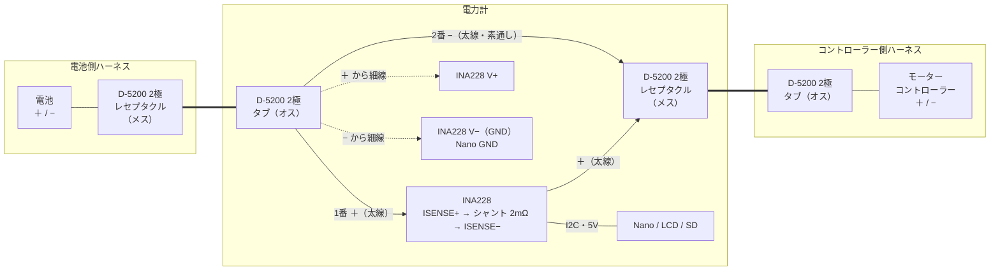

# Ene1PowerMeter

Ene-1 GP（電動カー競技）用の車載電力計。Arduino Nano で INA228 から電圧・電流・電力・積算 mAh を読み、車輪の速度センサーから速さと走った距離を数え、20×4 I2C 液晶に表示して microSD に CSV で記録する。

ログを振り返るテレメトリー画面（[tools/log_viewer](tools/log_viewer)）と、鈴鹿サーキットの走行シミュレーション（[tools/suzuka_sim](tools/suzuka_sim)）も入っている。これまでの経緯・決めたこと・前提・未解決の質問・次の作業は [docs/HANDOVER.md](docs/HANDOVER.md) にまとめてある（作業を引き継ぐ人と AI エージェントはここから読む。エージェント向けの決まりは [AGENTS.md](AGENTS.md)）。

## ハードウェア

全体の配線図・電線の一覧・電源を入れる前の確かめ方は [docs/WIRING.md](docs/WIRING.md)。

| 部品 | 内容 |
|---|---|
| マイコン | Arduino Nano（ATmega328P / 5V） |
| 電流・電圧センサー | Strawberry Linux #11228（INA228、シャント 2mΩ、I2C 0x40）。ローレンジ（±40.96mV）で 20A まで測定 |
| 表示 | 秋月 ACM2004D-FLW-FBW-IIC（20×4、RW1063） |
| 記録 | microSD モジュール（SPI、CS = D10） |
| ボタン | D2–GND 間（3 秒以上押して離す＝積算リセット） |
| 速度センサー | 車輪に付けた磁石と、車体側のホール IC（オープンドレイン出力）。D3 に入力。[下の取り付け](#速度センサー車輪の磁石とホール-ic) |
| 大電流の端子 | TE Dynamic D-5200 シリーズ 2 極（電池側・モーターコントローラー側に 1 組ずつ）。[下の配線](#電池モーターコントローラーとの接続te-dynamic-d-5200) |

| ピン | 用途 |
|---|---|
| A4 / A5 | I2C SDA / SCL（4.7kΩ で 5V へプルアップ） |
| D10 / D11 / D12 / D13 | SD の CS / MOSI / MISO / SCK |
| D2 | ボタン |
| D3 | 速度センサー（INT1 の割り込みで数える。4.7kΩ で 5V へプルアップ） |

### INA228 モジュール（#11228）の配線

基板の印字とメーカーの図による。

| 端子 | つなぎ先 |
|---|---|
| ISENSE+ | 電池＋（電流の入口。シャント 2mΩ を通って ISENSE− へ） |
| ISENSE− | モーターコントローラー＋（電流の出口） |
| V+ | 電池＋（バス電圧の測定用。**ISENSE+ とは基板上でつながっていないので、別に配線する**。未接続だと電圧と電力が 0 になる。mAh は電流だけから積算するので影響しない） |
| V−（GND） | 電池− |
| VS | Nano の 5V（3〜5V） |
| GND | Nano の GND |
| SDA / SCL | A4 / A5 |
| AL | 使わない（未接続でよい） |

- **I2C アドレスのジャンパー**: A1 と A0 を、それぞれ `G`（GND）の列とはんだでつなぐと 0x40 になる。どこにもつながっていない（浮いている）と INA228 のアドレスが定まらないので、必ずつなぐ。
- モジュールの GND と V− の関係、I2C のプルアップ抵抗が基板に載っているかどうかは未確認。載っていれば、外付けの 4.7kΩ と並列になる。電源を切った状態で、SDA–VS 間の抵抗をテスターで測って確認する。
- ねじ端子の電流定格は未確認。20A 近く流すなら、シャント両側の金色の大きなパッド（穴あき）の用途を基板で確認する。

### 電池・モーターコントローラーとの接続（TE Dynamic D-5200）

電力計は、電池とモーターコントローラーの間に **D-5200 の 2 極コネクタ 2 組**で割り込ませる。電力計を外したときは、電池側とコントローラー側のハーネスを直接つなげば走れる。



| 極 | 電池側ハーネス（レセプタクル） | 電力計の入口（タブ） | 電力計の出口（レセプタクル） | コントローラー側ハーネス（タブ） |
|---|---|---|---|---|
| 1 番 | 電池＋ | → INA228 ISENSE+、細線で V+ | ← INA228 ISENSE− | → コントローラー＋ |
| 2 番 | 電池− | → 出口の 2 番へ素通し、細線で INA228 V−・Nano GND | ← 入口の 2 番 | → コントローラー− |

- **どちらがオスか**: 電気が来ている側（電池側ハーネスと、電力計の出口）を**レセプタクル（メス）**にする。抜いたとき、電気の来ている金属がむき出しにならない。電池側（メス）とコントローラー側（オス）がそのままはまるので、電力計を外しても走れる。
- **極の割り当て**: 4 か所とも 1 番＝＋、2 番＝− にそろえる。ハウジングに極の番号が刻印されているので、圧着の前に確かめる。
- **太線にするところ**: 電池＋→ISENSE+、ISENSE−→出口の 1 番、入口の 2 番→出口の 2 番（−の素通し）。どれも 20A 流れるので、**AWG14（約 2mm²）以上**にする。コンタクトが使う電線の太さに合っているかを、品番で確かめる。
- **細線でよいところ**: V+ と、INA228 の V−（GND）・Nano の GND への線。電流はほとんど流れない。V+ は ISENSE+ と基板上でつながっていないので、入口の 1 番から別に引く（[上の表](#ina228-モジュール11228の配線)）。
- **GND を共通にする**: Nano の GND は、入口の 2 番（電池−）から 1 本でつなぐ。INA228 は GND を基準に電圧を測るので、ここがつながっていないと電圧と電力がおかしくなる。モーターの電流が流れる線の途中ではなく、コネクタの 2 番から直接引く（[TROUBLESHOOTING](docs/TROUBLESHOOTING.md) の「電圧が負荷で大きく下がって見える」）。
- **定格**: TE の資料では D-5200 は UL 45A・630V・ピッチ 10.16mm。20A には余裕があるが、コンタクトに対する電流値は電線の太さで変わるので、使うコンタクトの資料で確かめる。
- **キー**: 誤ってほかのコネクタとはまらないようにするキー（ハウジングの種類）がある。電池側とコントローラー側を直接つなぐ使い方をするので、**4 か所とも同じキーのハウジング**にそろえる。
- **圧着**: コンタクトは専用の圧着工具で圧着する。ペンチでかしめると、振動で抜けたり発熱したりする。ロックが「カチッ」と鳴るまで差し込む。

### 速度センサー（車輪の磁石とホール IC）

車輪に磁石を付け、車体側のホール IC（磁石が近づくと出力が LOW になるセンサー）の前を磁石が通るたびに 1 パルスを数える。パルスの間隔から速さを、数から走った距離を出す。

| 部品 | 内容 |
|---|---|
| センサー | ホール IC のデジタルスイッチで、**オープンドレイン（オープンコレクタ）出力・5V で動く**もの。例: TI DRV5033（オムニポーラ: 磁石の N・S どちらにも反応するので、向きを気にしなくてよい）、DRV5023（ユニポーラ: 片方の極だけに反応する。反応しなければ磁石を裏返す） |
| 磁石 | ネオジム磁石（直径 6〜10mm 程度）を、ホイールのスポークかハブに 1 個。センサーとのすき間は 2〜5mm から始め、実際に回して反応するか確かめる |
| 代わりに | 自転車のサイクルコンピューター用のセンサー（リードスイッチ。スポークに付ける磁石付き）も、2 本の線を D3 と GND につなげば使える。チャタリングはスケッチが捨てる |

| センサーの端子 | つなぎ先 |
|---|---|
| VCC（VDD） | Nano の 5V。センサーのすぐ近くで VCC–GND 間に 0.1µF のコンデンサーを付ける |
| GND | Nano の GND |
| OUT | D3。Nano の近くで、D3–5V 間に 4.7kΩ（プルアップ）、D3–GND 間に 10nF（0.01µF）を付ける |

- **外付けの抵抗とコンデンサー**: スケッチは D3 の内部プルアップ（数十 kΩ）も入れているので、なくても動く。ただ、モーターの近くを通る長い線では内部プルアップだけだとノイズを拾いやすいので付ける。4.7kΩ と 10nF で約 50µs のフィルターになり、磁石が前を通る間の LOW（数百 µs 以上）には影響しない
- **線**: 3 本をより合わせ（できればシールド線）、モーターとモーターコントローラーの線から離す。GND はモーターの電流が流れる線の途中ではなく、Nano の GND につなぐ
- **取り付け**: センサーは車体（フォークやフレーム）にしっかり固定する。振動ですき間が変わると、反応したりしなかったりする。リードスイッチは振動で余分に反応することがあるので、ホール IC のほうがよい

設定はスケッチ先頭の「速度センサー」の節で変える。

| 設定 | 初期値 | 内容 |
|---|---|---|
| `WHEEL_CIRCUMFERENCE_M` | 1.571 | 車輪 1 周で進む距離 [m]。速さと距離のすべてに効くので、[校正](#速さと距離)で実測した値にする。初期値はタイヤの外径 0.50m（IRC EC-R 20×1.75）× π |
| `SPEED_MAGNETS` | 1 | 車輪 1 周あたりの磁石の数（1〜8）。磁石を増やしたら合わせる |
| `SPEED_MAX_KMH` | 110 | これより速くなる間隔のパルスは、チャタリング・ノイズとして捨てる（初期値では前のパルスから 51ms 以内）。実際の最高速より十分大きくする |
| `SPEED_MIN_KMH` | 3 | これより遅くなったら 0km/h と表示する（初期値ではパルスが 1.9 秒来なければ 0） |

速さの出し方:

- 車輪 1 周ぶん（`SPEED_MAGNETS` 個）のパルスの間隔の平均から出す。磁石の間隔がそろっていなくても誤差にならない。磁石 1 個なら、30km/h で 0.19 秒ごと、10km/h で 0.57 秒ごとに新しい値になる。低い速さで早く変わってほしければ磁石を増やす
- 減速中で次のパルスが遅れている間は、その遅れから出した速さ（今の速さより遅い値）を出す。`SPEED_MIN_KMH` を下回ったら 0
- 止まった状態から動き出した 1 パルス目では、間隔が分からないので 0 のまま。2 パルス目から出す
- 割り込みの中で D3 がまだ LOW かを確かめ、数 µs で消えるノイズは数えない。それより長く LOW になるノイズは見分けられないので、上の配線で防ぐ

## 表示

2 行目の `Q:` はリセットからの積算 mAh（INA228 の CHARGE レジスタ）。3 行目はリセットからの経過時間（100 分以上は `TIME 123:45`）と速さ（99.9km/h まで）。

```
V: 24.53V  I: 12.34A
P: 303W  Q:  1234mAh
TIME  12:34 32.5km/h
REC LOG003.CSV     *
```

4 行目の末尾の `*` は、記録するたびに点滅する。INA228 を走行中に設定し直したことがあれば、4 行目は `LOG003.CSV   INA!1 *` になる（[故障への備え](#故障への備え)）。

## ボタン

| 操作 | 動作 |
|---|---|
| 3 秒以上押して離す | 積算 mAh・経過時間・距離を 0 にして、新しいログファイルを作る。押している間は 4 行目に `RELEASE=RESET mAh` |
| 3 秒未満で離す | 何もしない |
| 10 秒以上押したまま | 配線のショートとみなし、離しても何もしない（4 行目に `BUTTON STUCK?`） |

リセットを「離したとき」に行うのは、ボタン線が挟まれて GND とショートしても走行中の積算が消えないようにするため。

SD カードの初期化は起動時だけ行う。走行中に `NO SD` になった場合は、電源を入れ直すまで記録しない（表示と積算は続く）。

## 故障への備え

何が起きても、**積算 mAh と電流の表示だけは続ける**ことを目標にしている。

- **電力計の電源が全部落ちたとき**（コネクタが一瞬抜けた、電圧が下がった、など）は、EEPROM（電源を切っても消えないメモリ）に 2 秒ごとに保存している積算 mAh・経過時間・距離から続きを数える。2 行目に `RESTORED (mAh KEPT)` と出る。数えられないのは、最後の保存から電源が落ちるまで（最大 2 秒）と、電源が落ちていた間の分。**積算を 0 にするのはボタンの 3 秒長押しだけ**なので、新しいレースの前は長押しで 0 にする（電源を入れ直しても 0 にはならない）。
  - 保存は 50 か所に順番に書くので、書き換え寿命（10 万回）に届くのは電源を入れている時間で約 2800 時間後。保存の途中で電源が落ちた分は見分けて、1 つ前の保存を使う
  - 速度センサーに対応する前のスケッチとは保存の形が違うので、このスケッチに書き換えると、それまでの積算と時間を引き継がないことがある。書き換えたら、長押しで 0 にしてから使う
- **起動時に INA228 が見つからないとき**も止まらず、つながるまで探し続ける。つながったら続きから数える。
- **INA228 が読めない間**（配線の抜け・ノイズ）は、1 行目に `INA228 I2C ERROR`、2 行目に最後に読めた積算 `LAST    Q:  1234mAh` を出す。INA228 の中では積算が続いているので、読めるようになれば正しい値に戻る。
- **Nano だけがリセットされたとき**（ウォッチドッグ、スケッチの書き込み、Nano のリセットボタンなど）は、INA228 に設定が残っていれば積算 mAh を消さずに再開する。経過時間と距離も、リセットで消えない RAM 領域（`.noinit`）から復元する。新しいログファイルは作るが、時刻と距離は続きから記録する。
- **走行中に INA228 の設定が消えたとき**（電源の瞬断など）は、それを検出して設定し直し、それまでの積算値を引き継ぐ。4 行目に `INA!回数` を表示する。
- **速度センサーの線が切れたとき・磁石が外れたとき**は、速さが 0 になるだけで、積算・表示・記録は続く。チャタリングや数 µs のノイズ、`SPEED_MAX_KMH` を超える間隔のパルスは数えない。INA228 が読めない間も、速さの表示は続ける。
- **LCD がノイズで化けたとき**に備え、5 秒ごとに初期化コマンドを再送する（表示は消さない）。
- **SD カードが抜けたとき**は、1 秒ごとの書き込み確定のあとにカードの状態を確かめ（CMD13、初期化はしない）、約 2 秒で `NO SD` にする。
- **I2C がノイズで固まったとき**は、Wire のタイムアウト（3ms）で復帰する。
- **処理が固まったとき**は、8 秒でウォッチドッグが Nano をリセットし、積算を引き継いで再開する（`USE_WATCHDOG`）。Optiboot の Nano（Arduino IDE で「ATmega328P」を選んで書き込める Nano）ではそのまま再開する。旧ブートローダの Nano（「ATmega328P (Old Bootloader)」）では再起動を繰り返して表示が止まるので、Optiboot を書き込むか `USE_WATCHDOG 0` にする。
- **SD にログが大量にたまっても**、空き番号を二分探索で探すので起動は遅くならない。

それでも数えられないもの:

- **20A を超える電流**: 測定範囲（`INA_ADCRANGE = 1`）を超えた分は 20A として数えるので、積算が少なくなる（1 行目が `OVER`）。超えるなら `INA_ADCRANGE = 0`・`MAX_CURRENT_A = 81.92` にする
- **INA228 の電源も Nano の電源も落ちていた間**の電流（INA228 が積算しているのは電源が入っている間だけ）
- **LCD が壊れたとき**の表示（積算と記録は続く）

動かないときは [docs/TROUBLESHOOTING.md](docs/TROUBLESHOOTING.md) を参照。

## ログ

`LOG000.CSV`, `LOG001.CSV` … の空き番号に **50ms ごと（1 秒に 20 行）** 記録する。

```
time_s,voltage_V,current_A,power_W,charge_mAh,speed_kmh,distance_m
12.350,24.012,10.034,240.93,34.41,32.51,104.8
12.400,24.010,10.051,241.32,34.55,32.51,104.8
```

- `time_s`：経過時間（秒、ミリ秒まで）。行を書いた時刻なので、刻みは数 ms ずれることがある
- `charge_mAh`：INA228 の CHARGE レジスタ（符号付き。回生分は差し引かれる）
- `speed_kmh`：その時点の速さ（[速さの出し方](#速度センサー車輪の磁石とホール-ic)）。新しいパルスが来るまでは同じ値が並ぶ
- `distance_m`：リセットからの走った距離。パルスの数 × 1 パルスの距離（`WHEEL_CIRCUMFERENCE_M` ÷ `SPEED_MAGNETS`）なので、その刻みで増える
- 速度センサーに対応する前のスケッチの CSV には、最後の 2 列がない（ログビューアはどちらも読める）
- 書き込みの確定は 1 秒ごと。電源が落ちると最大 1 秒分の行が残らない
- 2 時間で約 14 万行・約 7MB。Excel（約 100 万行まで）でそのまま開ける

記録間隔はスケッチ先頭の `LOG_INTERVAL_MS` で変えられる。

| 設定 | 結果 |
|---|---|
| 50ms（初期値） | INA228 は 16 回平均で約 18ms ごとに更新。どの行も新しい測定値 |
| 20ms 以下 | LCD の更新などが間に合わず、刻みが 10〜30ms にばらつく（エミュレーターで実測） |
| 100ms 以上 | `INA_AVG` を 3（64 回平均）に戻すと、1 行ごとの値のばらつきが小さくなる |

積算 mAh は記録間隔や平均回数に関係なく、INA228 がすべての変換結果を足し込んでいる（データシート 7.3.2）。
書き込みの遅い SD カードでは、書き込みを確定するたびに最大 0.75 秒ほど行が抜けることがある（表示と積算は止まらない）。

### ログを見る（tools/log_viewer）

[tools/log_viewer/index.html](tools/log_viewer/index.html) をブラウザで開き、SD カードの CSV をまとめて選ぶ（ドラッグでもよい）。インターネットにつながっていなくても動くので、サーキットのピットでも使える。`index.html` と `logviewer-core.js` を同じフォルダに置いておく。データは端末の外に送らない。

- **走行のつなぎ方**：Nano のリセットで分かれたファイル（時刻が続いている）は 1 つの走行につなぐ。ボタンの積算リセットや電源の入れ直しで時刻が 0 に戻ったファイルは、別の走行にする
- **数字のまとめ**：使用量 mAh、平均・最大電流、最低電圧、電力量 Wh、ばらつき（電流の 2 乗平均 ÷ 平均。電池の中の損失は一定電流のときの「ばらつき²」倍）、OVER（20A に張り付いた時間）、記録なし。速度センサーの列があれば、距離・平均と最高の速さ・電費（Wh/km と mAh/km）も出す
- **グラフ**：電流・電圧・電力・積算（と予算との差）・速さの時間変化を、時間軸をそろえて積む。ドラッグで範囲を選ぶとその範囲の数字が出て、拡大もできる。Nano のリセット・記録の抜け・OVER の位置に印を付ける
- **再生と計器盤**：▶ で走行を ×10〜×120 の速さで再生し、電流計の針・速さと距離・電圧・電力・積算・予算との差・残りに使える電流を、その時点の値で見られる。グラフをクリックするとその位置に移る
- **ペース配分**：使える量（mAh）とレース時間を入れると、積算のグラフに均等に使い切る線を引き、差と残りに使える電流を出す
- **比較**：複数の走行の使用量を、走行の始めからの時間で重ねる。「別の日のログを追加」で、別の SD カードのログも並べられる
- 開いたときは作りもののサンプルを表示する（CSV を開くと置き換わる）。「サンプル」でいつでも戻せる
- 速度センサーに対応する前のスケッチの CSV（速さ・距離の列がない）も読める。その走行では速さのグラフと距離・電費を出さない
- 「鈴鹿シミュ」で、下の鈴鹿サーキットのシミュレーションを走らせて表示する（速さ・標高・ブレーカーの熱のグラフ付き）。`index.html` と同じリポジトリの `tools/suzuka_sim/suzuka-sim.js` を読むので、フォルダの並びはそのままにしておく

人に渡すときやスマホ・タブレットで開くときは、1 ファイルにまとめた配布版を作る（`logviewer-core.js` と `suzuka-sim.js` を中に入れる）。`tools/log_viewer/dist/` に `ene1-telemetry.html` と `使い方.txt` ができる（作り直せるので git には入れない）。

```bash
node tools/log_viewer/build-single.mjs
```

### 鈴鹿サーキットのシミュレーション（tools/suzuka_sim）

Ene-1 SUZUKA Challenge KV-40（フルコース 5.807km を止まった状態から 1 周 × 3 回、合計タイムで順位）を、車・電池・ブレーカー・ドライバーの物理モデルで走らせる。

- **コース**：2026 KV-40 特別規則 付則1 の ELEVATION 図から、標高（50m ごと）とカーブ半径を読み取った値
- **モーター**：M1048（24V）の特性図（電流ごとの回転数と効率）に合わせたモデル。自動進角・可変界磁で、回転が上がったら界磁を弱める（弱め方の下限と損失は見積もり）
- **車**：総重量 70kg（ドライバー込み）、スプロケット 25T → 60T、IRC EC-R 20×1.75（外径 0.5m）。空気抵抗（CdA 0.05）と転がり抵抗（Crr 0.003）は上位チーム並みの見積もりで、実測ではない
- **電池とブレーカー**：単3 20直列 × 2並列（公称 24V、1 本 20mΩ）、ブレーカー 10A（熱動式、12A で約 1 分で切れる近似）
- **運転**：ブレーキは最後のシケインだけ（40km/h）。デグナーなどは図の半径より大きく回るので減速しない

```bash
node tools/suzuka_sim/cli.mjs                    # 走り方を比べた表と、CSV (tools/suzuka_sim/out/)
node tools/suzuka_sim/cli.mjs --firmware         # さらに電流・電圧・速さ (車輪のパルス) をファームウェア (test/host_sim) に流して、電力計の記録を確かめる
node tools/suzuka_sim/cli.mjs --set cdA=0.04 --set massKg=65   # 車の値を変える
```

書き出す CSV は、走り方ごとに `LOG000.CSV`（電力計と同じ形。速さ・距離の列もあり、ログビューアで開ける）と `detail.csv`（速さ・区間・標高・勾配・モーター電流・ブレーカーの熱を足した表）。`LOG000.CSV` の距離は、電力計と同じく車輪が回った距離（速さの積分）で、ゴール後に止まるまでの分も含む。

結果の目安（既定の値）：10A 全開で 6:52 / 7:00 / 7:08（合計 21:00、電池 89%）、上りだけ 12A（勾配 2% 以上で、ブレーカーの熱が 85% になるまで）で合計 20:34。電池より先にブレーカーで決まる力が壁になる。空気抵抗・転がり抵抗・重さで結果が大きく変わるので、実測した値を入れて使う。

コースの標高は、大会資料の標高図を [digitize_elevation.py](tools/suzuka_sim/digitize_elevation.py) で読み取った値（コースの図が変わったら、同じやり方で作り直せる。使い方はスクリプトの先頭）。モデルの前提・感度・分かったことの詳細は [docs/HANDOVER.md](docs/HANDOVER.md)。

## ビルド

必要なライブラリ: SD（Wire / SPI は標準）

```bash
arduino-cli lib install SD
```

```bash
arduino-cli compile --fqbn arduino:avr:nano Ene1PowerMeter
```

## テスト

push と PR のたびに、GitHub Actions（[.github/workflows/test.yml](.github/workflows/test.yml)）が下の 3 つのテストを自動で回す。結果はリポジトリの Actions タブと PR の画面に出る。Arduino のコアと SD ライブラリのバージョンは workflow の中で固定している。

### 実機バイナリのエミュレーターテスト（test/avr_emu）

実機に書き込むのと同じ .hex を ATmega328P エミュレーター（[avr8js](https://github.com/wokwi/avr8js)）で動かす。I2C には INA228 と LCD（RW1063）のモデル、SPI には FAT32 イメージを持つ SD カードのモデル、D3 には車輪のパルス（チャタリングと 2µs のノイズも作れる）をつなぎ、Optiboot・旧ブートローダも一緒に動かして確認する。CSV はイメージから読み出し、FAT の整合性は `fsck.fat` で確かめる。

必要なもの: Node.js、arduino-cli（arduino:avr コアと SD ライブラリ）、dosfstools、mtools

```bash
cd test/avr_emu && npm install
```

```bash
cd test/avr_emu && node run.mjs
```

### PC 上のシミュレーション（test/host_sim）

スケッチを PC 用にコンパイルし、INA228・LCD・SD・速度センサー（車輪の回転と磁石、チャタリング、ノイズ）を模擬して動かす。速く、メモリ破壊・未定義動作の検査（`SIM_SANITIZE=1`）もできる。

```bash
bash test/host_sim/run_tests.sh
```

### ログビューアの計算（test/log_viewer）

PC 上のシミュレーションでスケッチを動かして CSV を作り、ログビューアの計算部分（`logviewer-core.js`）で読んで、走行のつなぎ方・集計（距離・速さ・電費を含む）・ペース配分が正しいかを確かめる。速度センサーに対応する前の CSV が読めることも確かめる。スケッチの CSV の形が変わってビューアが読めなくなったら、ここで気づける。必要なもの: g++、Node.js

```bash
bash test/log_viewer/run_tests.sh
```

## 校正

### 電流

基準の電流計と比べて電流がずれる場合は、`R_SHUNT_OHM` を調整する（表示が 1% 大きい → 0.002 × 1.01 = 0.00202）。電流・電力・積算 mAh のすべてに反映される。

### 速さと距離

`WHEEL_CIRCUMFERENCE_M`（車輪 1 周で進む距離）を実測した値にする。速さと距離のすべてに反映される。タイヤは空気圧と重さでつぶれるので、外径から計算した値（0.50m × π = 1.571m）より少し短い（1〜3% 程度）ことが多い。

1. **転がして測る**：ドライバーが乗った状態で、タイヤの接地点と床に印を付け、車をまっすぐ押してタイヤを 5〜10 周させ、進んだ距離を周数で割る。空気圧はレースと同じにする
2. **走って確かめる**：距離の分かる区間を走り、CSV の `distance_m` の増え方と比べる。例: 鈴鹿のフルコース 5.807km の 1 周で 5.900km 増えていたら、1.571 × 5.807 ÷ 5.900 = 1.546。走るライン（内側か外側か）で実際の距離は少し変わる

## 状態

LCD の I2C 仕様と初期化手順は RW1063 データシート（Rev.0.5）で確認済み。

- I2C アドレスは 0x3C〜0x3F のどれか（モジュール基板の SA1/SA0 の配線で決まる）。起動時に `LCD_ADDR`（0x3C）から応答を確かめ、なければ 0x3C〜0x3F を自動で探す。見つかったアドレスはシリアルに出る。
- 初期化はデータシート p.32 の手順（Function set → Display ON → Clear → Entry mode）と待ち時間どおり。
- 20×4 の各行の先頭アドレス（00h / 40h / 14h / 54h）は、RW1063 の 2 行モードを 20 文字ずつ折り返す一般的な配置。実機で行の順番が正しいか確認すること。
