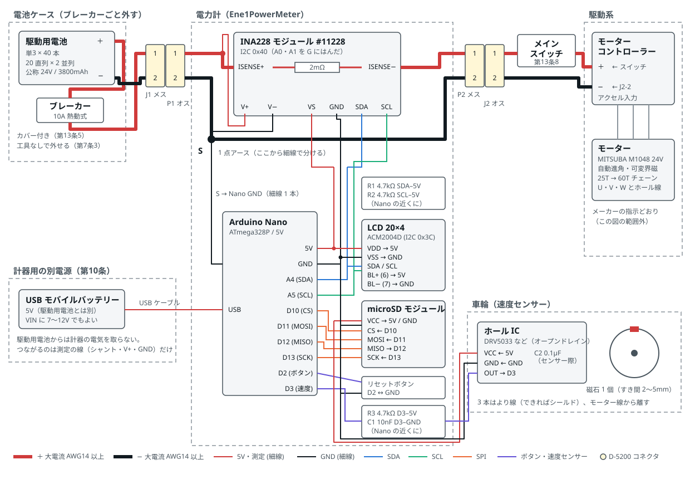

# 配線図

Ene1PowerMeter を Ene-1 KV-40 の車に組み込むときの配線。電池（単3 20 直列 × 2 並列、公称 24V）・ブレーカー 10A・D-5200 コネクタ・メインスイッチ・モーターコントローラーと、電力計の中身（INA228・Nano・LCD・microSD・ボタン・速度センサー）をまとめて描いた。



- 太線は駆動用の大電流（最大 20A）。細線は 5V・測定・信号
- 端子番号を確かめられなかったもの（LCD の BL+・BL− 以外の端子、microSD モジュールの並び）は、働きの名前で書いた。基板の印字で確かめてからつなぐ

## 1. 全体の流れ

```
電池＋ → ブレーカー 10A → J1-1 ⇔ P1-1 → INA228 ISENSE+ → シャント 2mΩ → ISENSE− → P2-1 ⇔ J2-1 → メインスイッチ → コントローラー＋
電池− ─────────────────── J1-2 ⇔ P1-2 ─────────（電力計の中を素通し）───────── P2-2 ⇔ J2-2 ─────────────────→ コントローラー−
                                         └ S（1 点アース）→ INA228 V−、Nano GND
```

電力計を外したときは、J1 と J2 を直接つなげば走れる（J1 はメス、J2 はオス、どちらも 1 番＝＋、2 番＝−）。

## 2. 電線の一覧

| 番号 | どこから | どこへ | 太さ | メモ |
|---|---|---|---|---|
| W1 | 電池ケース＋ | ブレーカー | AWG14 以上 | 電池ケースの中。ブレーカーはケースと一緒に外せるようにする（第7条3） |
| W2 | ブレーカー | J1-1 | AWG14 以上 | |
| W3 | 電池ケース− | J1-2 | AWG14 以上 | |
| W4 | P1-1 | INA228 ISENSE+ | AWG14 以上 | |
| W5 | INA228 ISENSE− | P2-1 | AWG14 以上 | |
| W6 | P1-2 | P2-2 | AWG14 以上 | −の素通し。途中で切らない |
| W7 | J2-1 | メインスイッチ | AWG14 以上 | スイッチは 10A 以上・DC 30V 以上の定格のもの |
| W8 | メインスイッチ | コントローラー＋ | AWG14 以上 | |
| W9 | J2-2 | コントローラー− | AWG14 以上 | |
| W10 | P1-1 | INA228 V+ | 細線（AWG24 など） | バス電圧の測定。**ISENSE+ と基板上でつながっていない**ので必ず引く |
| W11 | S（P1-2 の端子） | INA228 V− | 細線 | S は P1-2 の圧着端子の根元。モーターの電流が流れる線の途中から取らない |
| W12 | S | Nano GND | 細線 | 電力計の GND はここ 1 本だけで電池−につなぐ |
| W13 | Nano 5V | INA228 VS | 細線 | |
| W14 | Nano GND | INA228 GND | 細線 | |
| W15 | Nano A4 | INA228 SDA・LCD SDA | 細線 | R1 4.7kΩ で 5V へ |
| W16 | Nano A5 | INA228 SCL・LCD SCL | 細線 | R2 4.7kΩ で 5V へ |
| W17 | Nano 5V / GND | LCD VDD・BL+（6 番）/ VSS・BL−（7 番） | 細線 | コントラスト（V0）は未接続 |
| W18 | Nano 5V / GND | microSD VCC / GND | 細線 | |
| W19 | Nano D10・D11・D12・D13 | microSD CS・MOSI・MISO・SCK | 細線 | |
| W20 | Nano D2 | ボタン → GND | 細線 | 押すと D2 が GND につながる |
| W21 | Nano 5V / GND / D3 | 速度センサー VCC / GND / OUT | 細線 3 本 | より線（できればシールド）。モーター線から離す |
| W22 | USB モバイルバッテリー | Nano USB | USB ケーブル | 計器用の別電源（第10条）。7〜12V の別電池を VIN につないでもよい |

## 3. 端子ごとのつなぎ先

### Arduino Nano

| 端子 | つなぎ先 |
|---|---|
| USB（または VIN） | 計器用の別電源 |
| 5V | INA228 VS、LCD VDD・BL+、microSD VCC、速度センサー VCC、R1・R2・R3 |
| GND | S（1 点アース）、INA228 GND、LCD VSS・BL−、microSD GND、ボタン、速度センサー GND、C1 |
| A4 (SDA) / A5 (SCL) | INA228・LCD の SDA / SCL（I2C で共用） |
| D2 | ボタン（内部プルアップ、押すと LOW） |
| D3 | 速度センサー OUT（R3 4.7kΩ で 5V、C1 10nF で GND） |
| D10 / D11 / D12 / D13 | microSD の CS / MOSI / MISO / SCK |

### INA228 モジュール（#11228）

| 端子 | つなぎ先 |
|---|---|
| ISENSE+ | P1-1（電池＋側） |
| ISENSE− | P2-1（コントローラー＋側） |
| V+ | P1-1 から細線で別に |
| V−（GND） | S から細線で |
| VS / GND | Nano 5V / GND |
| SDA / SCL | Nano A4 / A5 |
| A0・A1 | それぞれ `G` の列とはんだでつなぐ（I2C アドレス 0x40） |
| AL | 未接続 |

### D-5200 コネクタ（2 極、4 か所とも 1 番＝＋、2 番＝−、同じキー）

| コネクタ | 側 | 種類 | 1 番 | 2 番 |
|---|---|---|---|---|
| J1 | 電池ケース側 | レセプタクル（メス） | ブレーカー経由の電池＋ | 電池− |
| P1 | 電力計の入口 | タブ（オス） | ISENSE+、V+ | 素通しの−、S |
| P2 | 電力計の出口 | レセプタクル（メス） | ISENSE− | 素通しの− |
| J2 | コントローラー側 | タブ（オス） | メインスイッチ経由でコントローラー＋ | コントローラー− |

電気が来ている側（J1、P2）をメスにして、抜いたときに電気の来ている金属がむき出しにならないようにする。コンタクトは専用工具で圧着する。

### 速度センサー（ホール IC）

| 端子 | つなぎ先 |
|---|---|
| VCC | Nano 5V（センサーの際で VCC–GND に C2 0.1µF） |
| GND | Nano GND |
| OUT | Nano D3（Nano の近くに R3・C1） |

磁石は車輪に 1 個、センサーとのすき間は 2〜5mm から。車輪 1 周の距離と磁石の数はスケッチの `WHEEL_CIRCUMFERENCE_M`・`SPEED_MAGNETS` で合わせる（[README](../README.md#速度センサー車輪の磁石とホール-ic)）。

### 速度センサーに CatEye VELO 9 の線を流用する場合（リードスイッチ）

有線のサイクルコンピューター（VELO 9 など）のセンサーは、磁石が近づくと 2 本の線がつながるリードスイッチ。スケッチはそのまま使える（設定の変更は要らない）。

| VELO 9 の線 | つなぎ先 |
|---|---|
| どちらか 1 本 | Nano D3（Nano の近くの R3 4.7kΩ → 5V、C1 10nF → GND は、ホール IC のときと同じく付ける） |
| もう 1 本 | Nano GND |

- 向きはない。電源が要らないので、W21 の VCC の線と C2 は付けない（W21 は 2 本になる）
- **線の取り出し**：センサーの線は、本体を載せる台座（ブラケット）の金属の接点まで来ている。台座の近くで切るか、接点からはんだで取り出す。どの 2 本がセンサーかは、テスターの導通モードで、磁石を近づけたり離したりして確かめる（近づけると導通、離すと切れる）
- **延長**：より線を足し、モーターの線から離して通す
- **磁石**：付属のスポーク用の磁石が車のホイールに付かなければ、ネオジム磁石を接着する。センサーとのすき間は 5mm 以内が目安
- **チャタリング**：つながる瞬間のばたつきは、`SPEED_MAX_KMH`（初期値 110km/h）より速くなる間隔のパルスとしてスケッチが捨てる
- **振動**：強い振動でスイッチが余分に反応することがある。ログの速さに不自然なとげが出るなら、取り付けを固くするか、ホール IC に替える

## 4. GND のつなぎ方

- 電力計の GND（INA228 V−・Nano GND）は、**P1-2 の端子の根元（S）から細線で取る 1 本だけ**で電池−につなぐ
- −の太線（W6）の途中や、コントローラー側から取らない。モーターの大電流が流れる線の電圧降下が測定に入り、電圧が負荷で下がって見える
- 計器用の別電源の−は、Nano の中で GND につながる。電力計の中の GND は、どこでも S を通って電池−と同じ電位になる

## 5. 規則との対応（2026 KV-40 統一規則・特別規則）

| 条文 | 決まり | この配線では |
|---|---|---|
| 第7条 3) | 電池はブレーカーごと、工具なしで外せる | ブレーカーを電池ケースの中に入れ、J1 で切り離す |
| 第10条 | 計器は別電源でよいが、駆動系と別系統であることを証明する | 電力計は USB モバイルバッテリーで動かす。駆動用電池とつながるのは測定の線（シャントを通る電流、V+、GND）だけ。V+ の入力電流はごくわずかで、計器を動かす電気は駆動用電池から取らない、と説明できるようにしておく |
| 第13条 5) | 電池とブレーカーにカバーを付ける | 電池ケースにふたを付け、ブレーカーもその中に |
| 第13条 7) | 電池の接点が振動で外れない | D-5200 はロック付き。電池ホルダーも確かめる |
| 第13条 8) | ブレーカーとは別のスイッチ。OFF ならアクセルを踏んでも走らない | メインスイッチをコントローラー＋の手前に入れる（コントローラーに起動スイッチの入力があれば、それを使ってもよい） |
| 第15条 | 電池 1 系統ごとに適切な容量のブレーカー | 20 直列 × 2 並列をまとめて 1 系統とし、10A を 1 個（規則の例の図では、12V-20A は 10 直列 × 4 並列にブレーカー 1 個、48V-5A は 40 直列に 1 個。どれも 240W で、24V なら 10A）。並列の列ごとに分けて付ける形（例の図のセレクター式）にするなら、列ごとに 5A になる。迷ったら車検の前に事務局に確かめる |
| 第7条 6) | 回生で電池を充電する装置は付けない | 付けていない |

## 6. 電源を入れる前に確かめること

テスターで、電池を外した状態で確かめる。

1. **ショートがない**: J1-1 と J1-2 の間、P2-1 と P2-2 の間が導通していない
2. **＋の道**: P1-1 → ISENSE+ → ISENSE− → P2-1 が導通する（シャント 2mΩ なのでほぼ 0Ω）
3. **−の素通し**: P1-2 と P2-2 が導通する
4. **V+**: P1-1 と INA228 V+ が導通する（つなぎ忘れると電圧と電力が 0 になる）
5. **GND**: P1-2 と Nano GND が導通する。Nano GND と INA228 GND・LCD・microSD・速度センサーの GND が導通する
6. **I2C のプルアップ**: SDA–5V、SCL–5V がそれぞれ 4.7kΩ 前後（モジュールにもプルアップがあれば低めに出る）
7. **INA228 のアドレス**: A0・A1 が `G` とつながっている
8. **速度センサー**（リードスイッチのとき）: 磁石を近づけると D3–GND が導通し、離すと切れる

次に計器用の別電源だけをつなぎ、USB シリアル（115200bps）の起動メッセージで `I2C scan: 0x3C(LCD?) 0x40(INA228)` が出ることを確かめる。最後に電池をつなぎ、LCD の電圧が電池の電圧と合うか、電流が 0.00A 付近かを見る（[TROUBLESHOOTING](TROUBLESHOOTING.md)）。
